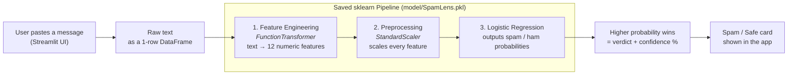

# 🔍 SpamLens: Email & SMS Spam Detector

**Paste a message. Get an instant spam or ham verdict, with a confidence score.**

SpamLens is an end-to-end machine learning project: a labelled dataset of ~5,500 messages, EDA and feature engineering, a comparison of 7 classification algorithms, and a tuned **Logistic Regression** model served through a **Streamlit** web app.

🔗 **Live demo:** 

| Accuracy   | Spam Precision | Spam Recall | Spam F1    |
| ---------- | -------------- | ----------- | ---------- |
| **98.68%** | **97.84%**     | **91.42%**  | **94.51%** |

---

## 🎯 What does it do?

Spam is annoying, but a real email wrongly sent to the spam folder is worse. SpamLens reads a message and tells you whether it looks like **spam** or **ham** (legitimate), along with how confident it is.

**You provide:** the raw text of an email or SMS. **You get:** a verdict and a confidence percentage.
> Example output: **Spam Detected** *(Confidence: 96.4%)*

---

## 🏗 How it works (architecture)

The whole system is **one saved scikit-learn `Pipeline`**.



---

## 📦 The dataset

|                    |                                                 |
| ------------------ | ----------------------------------------------- |
| **Source file**    | `data/email.csv`                                |
| **Raw size**       | 5,572 rows × 2 columns (`Category`, `Message`)  |
| **After cleaning** | 5,157 rows                                      |
| **Target**         | `Category` → `ham` (~87%) / `spam` (~13%)       |

The data is **imbalanced**: only ~12% of messages are spam. That is why accuracy alone is misleading here, and why I tracked spam precision, recall and F1 as well.

---

## 📁 Project structure

```
SpamLens/
├── app.py                          # Streamlit web app
├── train.py                        # builds and saves the final pipeline
├── feature_engineering.py          # the 12 text features (used inside the pipeline)
├── requirements.txt
│
├── data/
│   └── email.csv                   # raw data (5,572 rows)
│
├── model/
│   └── SpamLens.pkl                # trained pipeline (created by train.py)
│
└── notebooks/
    ├── Exploratory_Data_Analysis.ipynb
    ├── Feature_Engineering.ipynb
    ├── Naive_Bayes.ipynb
    ├── Logistic_Regression.ipynb
    ├── KNN.ipynb
    ├── SVM.ipynb
    ├── Decision_Trees.ipynb
    ├── Random_Forest.ipynb
    └── XG_BOOST.ipynb
```

---

## 🚀 Run it locally

**1. Clone and install**

```bash
git clone <your-repo-url>
cd SpamLens
pip install -r requirements.txt
```

**2. (Optional) Retrain the model**

```bash
python train.py
```

**3. Launch the app**

```bash
streamlit run app.py
```

Then open the local URL Streamlit prints (usually `http://localhost:8501`).

---

## 🛠 Tech stack

| Purpose         | Tools   |
| --------------- | --------------  |
| Language        | Python  |
| Data & analysis | pandas, NumPy   |
| Modeling        | scikit-learn    |
| Persistence     | joblib  |
| Web app         | Streamlit   |

---

<p align="center">Built by <b>Yash</b> · If you found this useful consider giving the repo a ⭐</p>
